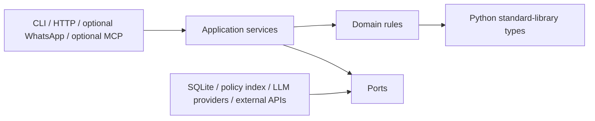
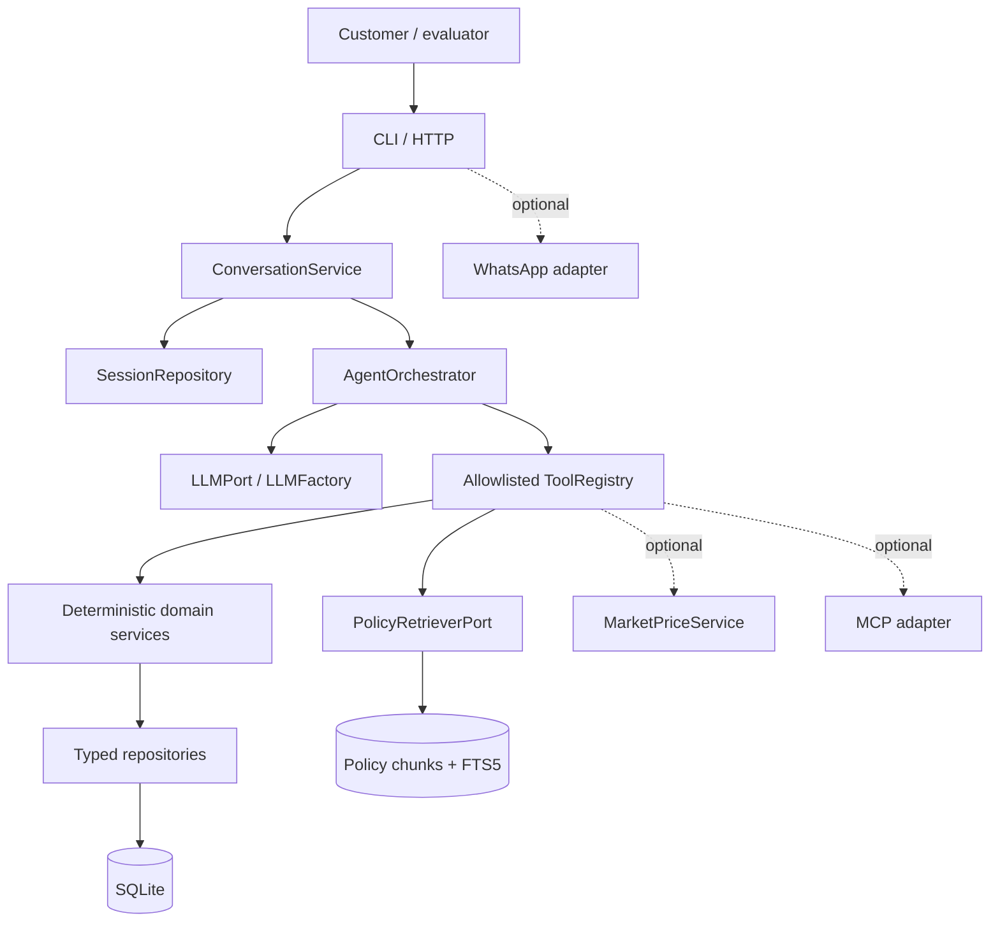

# Architecture Spine — Empório da Música Trusted AI Assistant

## Design Paradigm

Use Hexagonal Architecture. Business rules and application use cases depend on stable ports; delivery and infrastructure adapters implement those ports. The domain has no dependency on FastAPI, LLM SDKs, Meta, MCP, web search, or database libraries.



## Invariants & Rules

### AD-1 — Domain ownership of truth [ADOPTED]

- **Binds:** FR-3 through FR-8, FR-10, FR-11
- **Prevents:** LLM prompts, channels, or repositories independently redefining business rules.
- **Rule:** Product price, Promotion application, availability, payment calculation, shipping, Policy Provenance, and Order ownership are owned by deterministic domain/application services. The LLM may request a Tool but cannot author the returned fact.

### AD-2 — Inward dependency direction [ADOPTED]

- **Binds:** all components
- **Prevents:** provider, framework, database, or channel coupling leaking into business behavior.
- **Rule:** Delivery and infrastructure may depend on application, domain, and ports. Application may depend on domain and ports. Domain may depend only on domain types and standard-library abstractions. Domain and application never import provider SDKs or web frameworks.

### AD-3 — Single owner per state mutation

- **Binds:** Operational Snapshot, Policy Source, Session, Order access, optional External Offer
- **Prevents:** two units writing conflicting shapes or applying different validation.
- **Rule:** Each state family has one owning service/repository boundary: operational data ingestion owns snapshot tables; policy ingestion owns policy chunks/index; Session service owns session state; Order service owns ownership checks; Market service owns External Offer observations.

### AD-4 — Separate structured and policy retrieval [ADOPTED]

- **Binds:** FR-1 through FR-6, FR-10
- **Prevents:** approximate text retrieval answering exact price/stock/order questions or SQL facts being treated as policy prose.
- **Rule:** Operational questions use typed repositories and parameterized queries. Policy questions use a PolicyRetriever port returning bounded passages with section, page, source file, and document-version provenance. Neither path silently substitutes for the other.

### AD-5 — Normalized language-model boundary [ADOPTED]

- **Binds:** FR-10, SM-6
- **Prevents:** provider SDK types and capabilities leaking into the orchestrator or a provider being treated as universally compatible.
- **Rule:** Providers implement `LLMPort` through `LLMFactory`. Internal messages, tool calls, results, usage, and capabilities are normalized. Required capabilities are validated before execution. `FakeLLM` implements the same contract for offline tests.

### AD-6 — Allowlisted, bounded Tool execution

- **Binds:** FR-10, FR-11, security NFRs
- **Prevents:** arbitrary SQL, shell execution, dynamic imports, unknown tools, runaway cost, and prompt-driven authorization.
- **Rule:** `ToolRegistry` exposes only named schemas. The orchestrator validates arguments, checks server-side authorization, applies timeout and maximum-round budgets, executes only safe use cases, and returns structured results or an explicit failure.

### AD-7 — Server-side Order authorization [ADOPTED]

- **Binds:** FR-7, FR-8, UJ-3
- **Prevents:** order-ID enumeration and identity claims made in conversation text.
- **Rule:** An `AuthorizedPrincipal` is injected by the server/session boundary. The Order service must prove ownership before returning private data. Order ID, name, phone, or e-mail supplied in text is never authentication.

### AD-8 — One conversation application service

- **Binds:** FR-9 through FR-11, UJ-1 through UJ-4
- **Prevents:** CLI, HTTP, WhatsApp, or MCP implementing divergent conversation and safety behavior.
- **Rule:** All channels map to `InboundMessage` and `OutboundMessage` contracts and call the same `ConversationService`. Channel adapters validate transport concerns only; they do not contain catalog, policy, payment, or authorization rules.

### AD-9 — SQLite local persistence boundary [ADOPTED]

- **Binds:** P0 reproducibility, FR-2 through FR-9
- **Prevents:** a required remote database or hidden external state making the core prototype non-reproducible.
- **Rule:** P0 uses SQLite for the Operational Snapshot, policy chunks/index, Sessions, and test fixtures. Optional market observations remain a separate area. Database access is behind ports and uses parameterized queries and atomic ingestion.

### AD-10 — Optional integrations are adapters [ADOPTED]

- **Binds:** FR-12 through FR-14
- **Prevents:** WhatsApp, market search, or MCP credentials and outages becoming P0 dependencies.
- **Rule:** Optional capabilities are feature-flagged ports/adapters. Their absence or failure cannot prevent the offline P0 path. MCP and WhatsApp reuse existing use cases; Market Comparison never changes the official Product price.

### AD-11 — Sanitized observability

- **Binds:** security, reliability, and reproducibility NFRs
- **Prevents:** logs becoming a second unprotected customer database or an untraceable black box.
- **Rule:** Emit structured events containing correlation ID, hashed session ID, provider/model, tool name, duration, success, error class, and cache status. Exclude raw prompts, phone numbers, e-mails, names, and full tool payloads by default.

### AD-12 — Local-first operational envelope

- **Binds:** P0 scope and SM-3
- **Prevents:** development or evaluation requiring secrets, cloud services, or unverified integrations.
- **Rule:** The core suite runs with Python, uv-managed dependencies, SQLite, local fixtures, and `FakeLLM`. A real provider may be demonstrated separately. Deployment, secrets, and external adapters are explicit configuration, never implicit runtime requirements.

### AD-13 — Contract-led verification

- **Binds:** SM-1 through SM-4 and all port boundaries
- **Prevents:** a passing happy-path demo masking incompatible adapters or unsafe edge behavior.
- **Rule:** Every port has contract tests; domain rules have deterministic unit tests; ingestion and retrieval have integration tests; the conversation path has scenario tests covering authorization, injection, failure, ambiguity, and unsupported actions.

## Consistency Conventions

| Concern | Convention |
| --- | --- |
| Naming | Python `snake_case`; domain types and ports use `PascalCase`; ports end in `Port`; adapters identify the external system; Tool names are stable `verb_noun` identifiers. |
| IDs | Preserve source IDs for Products, Promotions, Customers, Orders, and order items. Use opaque internal IDs for Sessions/messages. Never use a Customer identifier as a public session identifier. |
| Money | Use `Decimal` and BRL minor-unit/rounding rules defined by the domain service; never use binary floating point for customer-visible calculations. |
| Dates | Store timezone-aware ISO-8601 timestamps for application events. Expose `data_as_of` for the Operational Snapshot and document that it is not live. |
| Provenance | Structured facts carry snapshot provenance; policy passages carry source file, document version, section, and page; External Offers carry retailer, URL, date, condition, and match confidence. |
| Errors | Use typed internal errors mapped by delivery adapters to stable safe responses. Do not expose stack traces, provider payloads, SQL, or private existence details. |
| Configuration | Environment/configuration selects provider and optional adapters from an explicit allowlist. User input never selects an import path or executable. |
| State mutation | Ingestion is validated and atomic. Session state is owned by `SessionRepository`; Order data is read-only in P0; optional external observations never overwrite official Product data. |
| Authorization | Authorization is checked at the application/domain boundary for every private-data use case, including non-HTTP adapters and MCP. |

## Stack

| Name | Version / status |
| --- | --- |
| Python | 3.13.7 observed in authoring environment; pin supported range in project metadata. |
| uv | 0.12.9 observed in authoring environment; use as project environment/package manager. |
| SQLite | Local P0 persistence; verify FTS5 availability in the supported runtime/CI. |
| SQLite FTS5 | Baseline policy full-text retrieval; embeddings remain deferred until evaluation proves a need. |
| Pydantic | v2 validation model; pin exact project version during bootstrap. |
| FastAPI | Optional P0 HTTP delivery adapter; pin exact project version during bootstrap if HTTP is selected. |
| Provider SDKs | Optional infrastructure dependencies; never imported by domain/application code and never required by offline tests. |

## Structural Seed



```text
project-root/
  src/
    domain/          # Product, Promotion, payment, shipping, ownership, provenance rules
    application/     # ConversationService, orchestrator, sessions, use cases
    ports/           # LLM, repositories, retrieval, channels, optional integrations
    tools/           # schemas and safe ToolRegistry boundary
    adapters/
      delivery/      # CLI, HTTP, optional WhatsApp/MCP
      infrastructure/ # SQLite, PDF/index, LLM providers, optional market provider
  tests/
    unit/ contract/ integration/ scenarios/ security/
  data/
    fixtures/        # anonymized and synthetic test data only
  docs/
    adr/             # accepted architectural changes
  pyproject.toml
```

### Deployment and environments

- **Offline test:** FakeLLM, SQLite temporary database, anonymized fixtures, no network.
- **Local demo:** SQLite snapshot, selected local channel, optional configured real provider.
- **Optional integration environment:** explicit secrets and feature flags for WhatsApp, market provider, or MCP; failures are isolated from P0.
- No production SLA, live ERP synchronization, or real authentication is implied by this spine.

## Capability → Architecture Map

| Capability / area | Lives in | Governed by |
| --- | --- | --- |
| FR-1 to FR-3 store and policy answers | PolicyRetriever, policy service, ConversationService | AD-1, AD-4, AD-11 |
| FR-4 to FR-6 catalog, price, promotions | Domain services + typed repositories + SQLite adapter | AD-1, AD-3, AD-9 |
| FR-7 to FR-8 order status | Order use case + AuthorizedPrincipal + repository | AD-1, AD-7, AD-11 |
| FR-9 session continuity | ConversationService + SessionRepository | AD-3, AD-8, AD-11 |
| FR-10 tool orchestration and provider swap | AgentOrchestrator + ToolRegistry + LLMFactory | AD-5, AD-6, AD-13 |
| FR-11 safe limitations | Application error/fallback policy | AD-1, AD-6, AD-11 |
| FR-12 WhatsApp | Channel adapter | AD-8, AD-10 |
| FR-13 market comparison | MarketPriceService + MarketSearchPort | AD-3, AD-10, provenance convention |
| FR-14 MCP | MCP delivery adapter over use cases | AD-7, AD-8, AD-10 |

## Deferred

- Exact Python dependency pins and starter layout: decide during bootstrap after confirming the implementation root.
- CLI versus HTTP as the first delivery surface: choose the smallest surface that demonstrates the P0 journeys; both may exist if they share the same service.
- Real LLM provider and model: select only when credentials, capabilities, cost, and evaluation needs are confirmed.
- FTS5 versus another lexical implementation: use FTS5 baseline; revisit only after retrieval evaluation shows a measurable gap.
- Embeddings/vector database: deferred until lexical retrieval fails the agreed evaluation threshold.
- Production authentication, deployment topology, scaling, retention, and operational SLA: outside the prototype altitude.
- WhatsApp delivery details, market provider contract, and MCP transport/security: deferred to their respective P1 stories.
- Publication and retention policy for raw customer CSV and internal PDF: a delivery/governance decision, required before public release.
