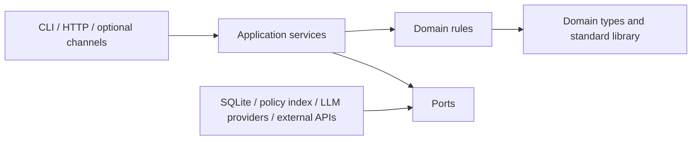
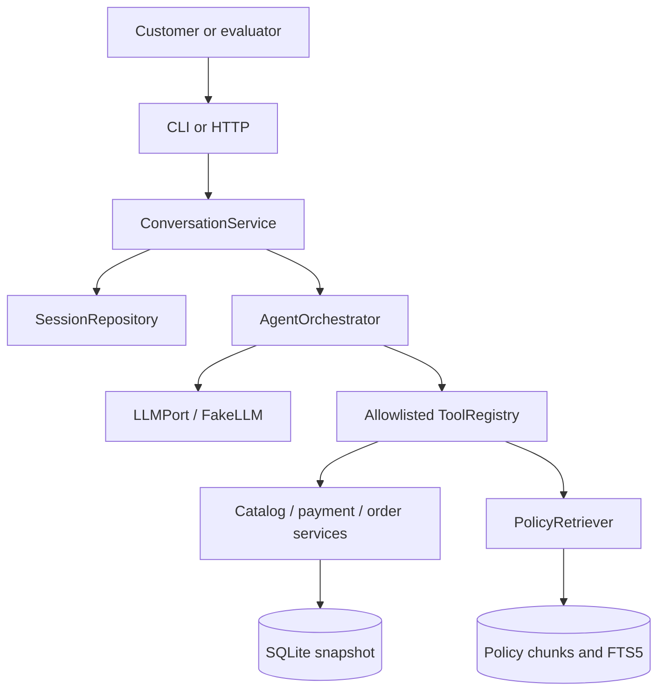

# Architecture Diagrams

## Dependency direction

## P0 runtime shape

## Runtime boundaries

- Offline test: FakeLLM, temporary SQLite, anonymized fixtures, no network.
- Local demonstration: SQLite snapshot, selected local channel, optional configured real provider.
- Optional integration environment: explicit secrets and feature flags; failures isolated from P0.
