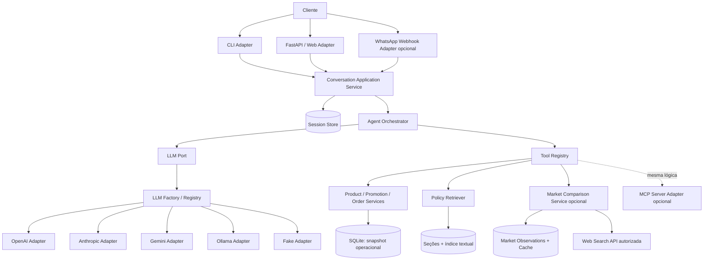
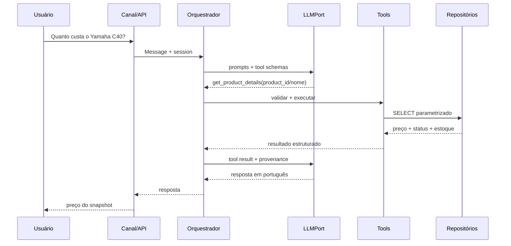

# Software Architecture V2 — Ports & Adapters

**Status:** proposta para revisão com BMAD. **Norte:** menor arquitetura que atenda ao enunciado e demonstre extensibilidade.

## Context diagram



MCP é um adaptador adicional dos **serviços de domínio**; não é necessário que o orquestrador local faça uma chamada de rede MCP para usar uma função local.

## Boundaries e dependências

- `api/`: validação HTTP, apresentação, request IDs; não importa bibliotecas concretas do provedor de IA.
- `channels/`: contratos de `InboundMessage`/`OutboundMessage`; WhatsApp faz mapping e verificação de assinatura.
- `application/`: `ConversationService`, `AgentOrchestrator`, gestão de sessão, autorização, rate limits.
- `domain/`: regras puras (preços com `Decimal`, promoções, disponibilidade, policies metadata, ownership).
- `ports/`: `LLMPort`, `ProductRepository`, `OrderRepository`, `PolicyRetrieverPort`, `MarketSearchPort`, `SessionRepository`, `OutboundChannel`.
- `infrastructure/`: OpenAI/Anthropic/Gemini/Ollama, SQLite, PDF index, web provider, Meta Cloud API.
- `tools/`: fronteira com o LLM, incluindo schema, limites e conversão de respostas; delega aos use cases.

**Regra:** adapters podem depender de application/domain/ports; domain não importa SDKs, FastAPI, Meta, LangChain ou DB.

## LLM Factory / strategy

Port mínimo assíncrono tipado:

```python
from typing import Protocol, Sequence

class LLMPort(Protocol):
    @property
    def capabilities(self) -> "ModelCapabilities": ...
    async def complete(
        self, messages: Sequence["LLMMessage"],
        tools: Sequence["ToolDefinition"],
        *,
        temperature: float | None = None,
        request_id: str,
    ) -> "LLMResult": ...

class LLMFactory:
    def create(self, config: "LLMConfig") -> LLMPort: ...
```

Modelos internos normalizados: `LLMMessage`, `ToolCall`, `ToolResult`, `LLMResult`, `Usage`, `ModelCapabilities`. Registrar `function_calling`, `structured_output`, `streaming`, `context_window` quando verificável; rejeitar configuration incompatível antes de executar. Provider/name configuráveis por env; não presumir que 'qualquer LLM' oferece as capacidades exigidas. `FakeLLM` obrigatório; pelo menos um provider real demonstrado em execução.

Factory instancia e delega ao adaptador; nenhum SDK nativo deve aparecer no `AgentOrchestrator`. Explicit provider allowlist; não permitir dynamic import vindo de input do usuário.

## Orchestration / tool calling

1. Criar/obter sessão e principal autorizado do **servidor**.
2. Construir system prompt + resumo/histórico limitado + mensagem corrente.
3. LLM escolhe tool(s) de registry allowlisted.
4. Validar argumentos Pydantic; checar autorização por ferramenta; executar com timeout.
5. Devolver resultado serializado, com `source` e `retrieved_at` quando cabível.
6. Repetir até resposta ou `max_tool_rounds`; fallback seguro em falha/limite.
7. Registrar eventos sanitizados e salvar sessão.

Não executar comandos arbitrários, SQL gerado livremente ou ferramentas desconhecidas. Pode haver tool calls paralelas somente se independentes e seguras.

## Retrieval / RAG

- `policy_ingest`: extrai PDF, segmenta por seção numerada, associa `section_id`, `page`, `document_version`, `source_file`, `text`.
- `policy_search`: indexação textual (SQLite FTS5 ou BM25) e retorno de top-k passagens curtas. Opcional embeddings se avaliações apontarem lacunas.
- `answer`: LLM responde com base nas passagens; se conteúdo insuficiente ou contraditório, pede contexto ou encaminha; resumos de políticas podem indicar seção.
- A fonte é documentação interna: **não devolver PDF integral nem exibir PII inadvertidamente**.

## Data storage

Banco SQLite com tabelas operacionais importadas dos 6 CSVs; tabelas de aplicação e mercado separadas. CSVs são snapshot; serviços expõem `data_as_of` / provenance e não relatam estoque em tempo real.

## Channel architecture

`InboundMessage(channel, external_message_id, external_user_id, text, timestamp, metadata)` => `ConversationService` => `OutboundMessage(channel, destination, text, correlation_id)`.

WhatsApp:
- Webhook verification / assinatura de payload, validação e deduplicação.
- Ack rápido; enfileirar/segregar trabalho se latência LLM exceder restrições do canal.
- Idempotência e retenção mínima de identificadores; contexto por tenant/channel/user.
- Meta Cloud API para envio por adapter com retry idempotente, dentro das regras de janela/template aplicáveis.
- Webhook fake e mock HTTP para CI; nunca exigir credenciais de Meta para suite principal.

## MCP strategy

Implementar **se** P0 estiver pronto: MCP tools como adapter para os mesmos serviços; tools de pedidos exigem principal autorizado, negam leitura anônima. Opcionalmente expor somente catálogo/políticas/mercado em MCP público e deixar pedidos fora. Não replicar regras SQL ou business logic no servidor MCP.

## Market price strategy

`MarketPriceService(product_id)` consulta cache com TTL e, quando configurado, um `MarketSearchPort`. Match por marca/modelo/variante/condição; dedup por lojista + anúncio; não misturar produtos usados, outros modelos ou condições de pagamento sem normalização. Expor `n`, `min`, `median`, `mean`, fonte, URL e data. Preço oficial permanece no snapshot `products.price_brl`. Falha externa = comparação indisponível, sem impacto no preço interno.

## Segurança e confiabilidade

- Threats: prompt injection no PDF/web; exfiltração via ferramentas; spoofing WhatsApp; tentativa de acessar pedido de terceiro; SQL injection; retenção de PII; custo LLM ilimitado.
- Defesa: dados externos são *dados*, não instruções; ferramenta allowlist e validação schema; autenticador server-side; query parametrizada; logs redigidos; limites de tamanho; timeout; tool-call budget; segredos no ambiente; cache de mercado com expiração.
- Sem autenticação real no protótipo, demonstração de pedidos somente com `DemoPrincipal` injetado em testes, claramente marcado; em canal anônimo, pedir contato humano/verificação externa.
- Preferir não colocar `customers.csv` em repo público antes de validar autorização de divulgação; testar com fixtures sintéticas.

## Observabilidade mínima

Eventos com `trace_id`, `session_id_hash`, `provider`, `model`, `tool_name`, `duration_ms`, `success`, `error_type`, `cache_hit`; não registrar prompt completo, telefone, e-mail ou nome por padrão.

## Diagramas de sequência



## Trade-offs de início

- **Um agente:** mais fácil controlar e avaliar que multiagentes.
- **SQLite:** suficiente para dados locais e testes, migração via ports.
- **Text retrieval antes de embeddings:** corpus pequeno e indexável por seção.
- **Não fazer uso obrigatório de MCP:** chamada local tem menos custo e complexidade.
- **WhatsApp desacoplado:** avaliação principal sem conta Meta.
- **Search externa opcional:** fornecedor e disponibilidade não podem prejudicar uso local.

## Engenharia assistida por IA: BMAD, Codex e Ponytail

**Separação de responsabilidades:** BMAD refina produto, histórias e decisões; Codex edita o código; Ponytail atua como orientação de simplicidade, revisão de diff, identificação de dívida e melhorias de manutenção no ambiente do desenvolvedor. **Ponytail não é provider LLM, agente de atendimento, serviço, adapter nem dependência de deploy.**

O uso de Ponytail não altera os boundaries existentes. Aplicar o princípio *minimum sufficient architecture*: reduzir código duplicado e abstrações sem consumidores reais, mas manter `LLMPort` + Factory, isolamento de canais, serviços determinísticos, segurança de pedidos e retrieval rastreável como invariantes acordados.

**Precedência de decisões:** fontes oficiais do exercício → requisitos e regras de segurança/privacidade → ADRs e contratos aprovados → critérios de aceite da story → propostas de simplificação do Ponytail. Se houver conflito, não aceitar a sugestão automaticamente; explicar trade-off e registrar revisão.

**Controle de risco:** plugins/hook scripts são código de terceiros com potencial de execução no ambiente local; revisar a origem, os scripts e permissões antes de habilitá-los, não conceder acesso desnecessário a segredos e permitir o fluxo sem o plugin caso não esteja disponível. Regras detalhadas em `PONYTAIL_WORKFLOW.md` e `docs/adr/ADR-004-ponytail-development-workflow.md`.

## Quality gates

Consulte `TEST_STRATEGY.md`, `ROADMAP.md` e os ADRs. Toda mudança de arquitetura exige atualização de ADR, teste de contrato e documentação.
