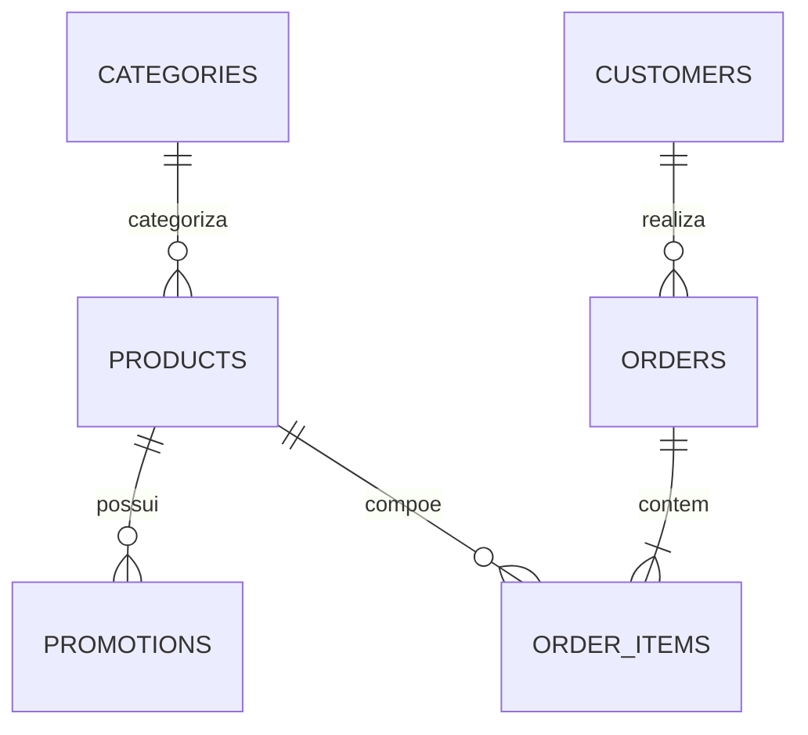

# Data Model — Diagnóstico dos arquivos recebidos

**Origem:** seis CSVs fornecidos para o desafio. Números e campos abaixo foram verificados localmente; são dados do exercício, não estoque/ERP vivo.

## Inventário

| Tabela | Linhas | Colunas |
|---|---:|---|
| `categories` | 9 | `category_id`, `name`, `description` |
| `products` | 65 | `product_id`, `price_brl`, `name`, `category_id`, `description`, `stock_quantity`, `status`, `specs`, `created_at` |
| `customers` | 50 | `customer_id`, `name`, `phone`, `email`, `city` |
| `orders` | 20 | `order_id`, `customer_id`, `order_date`, `status`, `total_brl`, `payment_method`, `tracking_code`, `estimated_delivery`, `notes` |
| `order_items` | 22 | `order_id`, `quantity`, `product_id` |
| `promotions` | 25 | `promotion_id`, `product_id`, `discount_percent`, `description`, `is_active` |

## Relacionamentos



IDs são inteiros; preços monetários devem ser convertidos para **`Decimal`** antes dos cálculos e persistidos como centavos inteiros ou decimal exato. `specs` contém JSON serializado como texto no CSV de produtos: validar e normalizar na ingestão.

## Observações reais encontradas

- `products.status`: `active` 62, `discontinued` 2, `coming_soon` 1.
- Há `active` com `stock_quantity=0`; há `discontinued` com `stock_quantity=13`; há `coming_soon` com `stock_quantity=2`. **Status e quantidade são duas condições diferentes.**
- `promotions.is_active`: quatro ativas / 21 inativas. IDs de produtos ativos em promoção: `127` (10%), `121` (20%), `90` (18%), `94` (8%).
- `orders.status`: `delivered` 7, `confirmed` 4, `pending` 4, `cancelled` 4, `shipped` 1.
- `orders.tracking_code` e `estimated_delivery`: 12 valores vazios cada; `notes`: 16 vazios.
- Em análise inicial, **nenhuma chave estrangeira inválida** nos relacionamentos `products→categories`, `promotions→products`, `orders→customers`, `order_items→orders`, `order_items→products` e nenhum registro integralmente duplicado.
- Pedido mais recente do snapshot: março/2026; datas estimadas não significam prazo atual e códigos não são rastreamento em tempo real.
- `products.created_at` é cadastro, não última atualização de preço/estoque.

## Disponibilidade

`is_available_for_sale = (status == 'active') AND (stock_quantity > 0)`.

- `discontinued`: não ofertar como disponível; sugerir equivalentes ativos.
- `coming_soon`: não confirmar compra, ainda que estoque seja positivo.
- `active + 0`: indisponível.
- A política do manual (§7.3) orienta informar indisponibilidade e oferecer alternativas.

## Promotions / pricing

`listed_price = products.price_brl` e `promotional_price` apenas se `promotions.is_active=1` e produto elegível. Uma vez promocional, desconto de PIX (5%) **não é cumulativo**. Não misturar desconto de campanha anunciada no PDF (orientação de marketing) com promoção ativa no CSV.

Se ocorrerem múltiplas promoções ativas para um produto, o enunciado não define precedência: na ingestão detectar e aplicar política documentada (por padrão rejeitar ou sinalizar para revisão; não somar percentuais).

## Auth / privacy

`orders.customer_id → customers.customer_id`. A existência de nome, e-mail e telefone no CSV **não substitui autenticação**. Uma `Principal` autenticada pelo servidor determina o `customer_id` autorizado; uma identidade digitada no chat não basta. Para demo, criar testes com principal explícita e casos de acesso negado. Não expor clientes por enumeração.

## Tabelas de aplicação propostas

```text
conversation_sessions(
  session_id, channel, external_user_hash, principal_customer_id_nullable,
  created_at, updated_at
)
conversation_messages(
  message_id, session_id, role, content_sanitized,
  created_at, token_usage_nullable
)
policy_chunks(
  chunk_id, source_file, document_version, section_id,
  section_title, page_number, content, indexed_at
)
market_price_observations(
  id, product_id, retailer, retailer_url, matched_model,
  condition, currency, price_minor_units, available,
  collected_at, match_confidence, source_provider
)
```

As tabelas de mercado não sobrescrevem `products`; `market_price_observations` guarda evidências por anúncio, não só média.

## Política de cache / dados externos

Proposta: TTL configurável (padrão a definir/testar, por exemplo 24 h) e ação explícita de atualização. Dados externos sem data ou link não sustentam média confiável. Produto idêntico, variante, condição e forma de pagamento devem ser verificados; além de média, usar mediana e contagem de fontes independentes.

## Pipeline de ingestão proposto

1. Validar existência, codificação, colunas esperadas e tipos.
2. Limpar valores nulos, converter datas ISO e moeda com `Decimal`.
3. Validar IDs únicos, FKs, status conhecidos, `stock_quantity>=0`, percentuais em intervalo válido, parse JSON.
4. Copiar para banco em transação atômica; falha de validação não deixa estado parcialmente importado.
5. Registrar `dataset_imported_at` e hash dos seis arquivos; evitar confundir com `last_updated_at` do preço.
6. Criar fixtures pequenas e não identificáveis para testes de publicação.

## Anomalias a testar

`stock_quantity=0`, `discontinued+positive_stock`, `coming_soon+positive_stock`, produto ausente, promoção inativa, pedido sem rastreio, status cancelado, pedido de outro usuário, preços na fronteira de parcelamento, códigos de rastreio sem consulta real.

## Informações institucionais vindas do PDF

Endereço: Rua 14 de Maio, 3200, Centro, Campo Grande/MS. Horário: seg–sex 9–18h; sábado 9–13h; domingo/feriados fechado. **Telefones divergentes:** tabela de dados da empresa usa `(67) 3341-4444`, seção WhatsApp usa `(67) 3321-4500`. Não declarar certeza de qual linha está conectada à API Meta.
